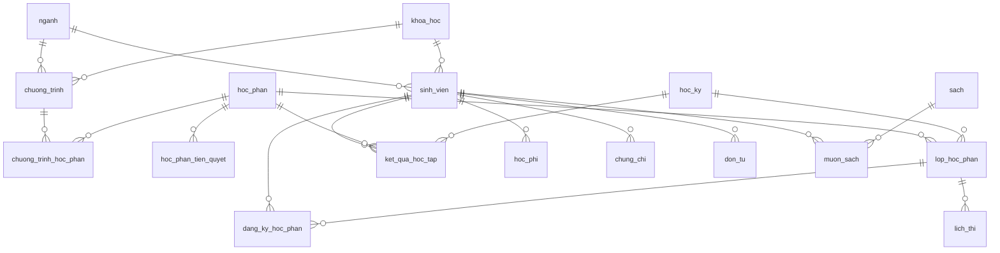
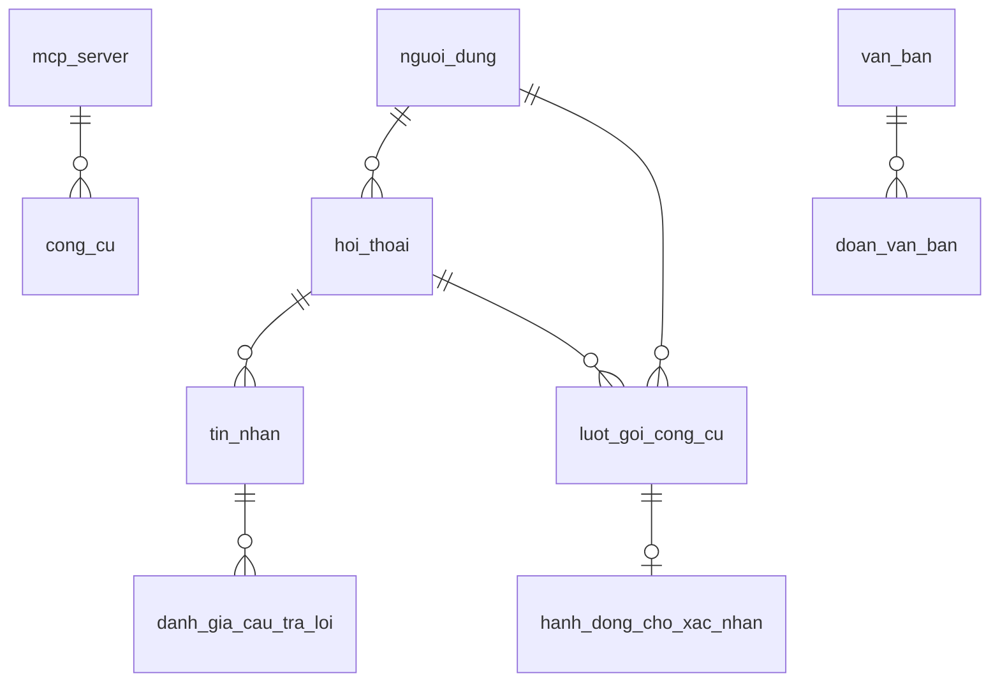

# 03. Cơ sở dữ liệu (Microsoft SQL Server)

Hai CSDL tách biệt, mô phỏng thực tế "hệ thống của trường" và "hệ thống trợ lý" thuộc hai nơi khác nhau:

**Bảng 3.1.** Hai CSDL của hệ thống

| CSDL | Ai dùng | Script |
|---|---|---|
| `tlhv_qlsv` | chỉ `qlsv_api` | `database/01_qlsv_schema.sql`, `03_qlsv_seed.sql` |
| `tlhv_assistant` | `assistant_api`, thư viện `rag` | `database/02_assistant_schema.sql`, `04_assistant_seed.sql` |

Tiền tố `tlhv_` (trợ lý học vụ) tránh trùng với CSDL có sẵn trên máy (vd. `QLSV` của bài tập khác — tên CSDL trong SQL Server không phân biệt hoa thường).

> **Lịch sử thiết kế:** bản thiết kế gốc dùng MySQL 8. Ngày 18/11/2026 chuyển sang SQL Server (Express) để quản lý bằng SSMS sẵn có trên máy phát triển. Tên bảng/cột giữ nguyên; xem bảng quy ước chuyển đổi bên dưới.

## Cài đặt
1. Cài SQL Server (bản **Express** miễn phí là đủ) + **SQL Server Management Studio (SSMS)** + **ODBC Driver 18 for SQL Server**.
   Máy phát triển hiện có instance `localhost\SQLEXPRESS01` (SQL Server 2025 Express).
2. Chạy lần lượt 4 file trong `database/` (thứ tự 01 → 02 → 03 → 04). Máy đã cài từ trước: chạy thêm các script nâng cấp `05` → `10` theo thứ tự (mỗi script chạy lại nhiều lần vẫn an toàn). Sau đó chạy `11_bo_sung_du_lieu_demo.sql` (dữ liệu demo bổ sung) và `12_du_lieu_mo_phong_hunre.sql` (dữ liệu mô phỏng theo HUNRE) — hai mục cuối tài liệu. Script 01, 02 tự tạo CSDL nếu chưa có, rồi xóa và tạo lại bảng.
   - **SSMS:** File → Open → chọn file → Execute (F5), lần lượt từng file.
   - **Dòng lệnh** (PowerShell, tại thư mục gốc dự án):
     ```powershell
     foreach ($f in '01_qlsv_schema','02_assistant_schema','03_qlsv_seed','04_assistant_seed','11_bo_sung_du_lieu_demo','12_du_lieu_mo_phong_hunre') {
       sqlcmd -S ".\SQLEXPRESS01" -E -C -f 65001 -b -i "database\$f.sql"
     }
     ```
     `-E`: đăng nhập Windows; `-C`: tin cậy chứng chỉ tự ký; `-f 65001`: đọc file UTF-8 (giữ dấu tiếng Việt).
3. Đăng nhập: mặc định dùng **Windows Authentication** (để trống `DB_USER`, `DB_PASSWORD` trong `.env`), tài khoản Windows đang chạy backend phải có quyền trên 2 CSDL (người cài SQL Server mặc định là sysadmin).
   Muốn dùng SQL Server Authentication: bật "SQL Server and Windows Authentication mode" trong SSMS (Server Properties → Security), tạo login rồi điền `DB_USER`, `DB_PASSWORD`.
4. Kiểm tra trong SSMS: `SELECT ma_sv, ho_ten FROM tlhv_qlsv.dbo.sinh_vien;` → 14 dòng (5 dòng nếu chưa chạy `11`), tên tiếng Việt đúng dấu.

## Quy ước chuyển đổi kiểu dữ liệu (MySQL → SQL Server)

**Bảng 3.2.** Quy ước chuyển kiểu dữ liệu từ MySQL sang SQL Server

| Thiết kế gốc (MySQL) | SQL Server | Lý do / lưu ý |
|---|---|---|
| `VARCHAR`, `TEXT`, `MEDIUMTEXT` + utf8mb4 | `NVARCHAR(n)`, `NVARCHAR(MAX)` | Lưu Unicode. Literal trong SQL phải viết `N'...'`, thiếu `N` sẽ mất dấu. Model dùng `Unicode`/`UnicodeText` |
| `ENUM(...)` | `NVARCHAR` + `CHECK (... IN (...))` | SQL Server không có ENUM; CHECK vẫn chặn giá trị sai |
| `JSON` | `NVARCHAR(MAX)` + `CHECK (ISJSON(...) = 1)` | `ISJSON` chỉ nhận **object/array** → kết quả dạng số/chuỗi phải bọc, vd `{"gia_tri": ...}`. Model dùng `JSON(none_as_null=True)` để `None` lưu thành `NULL` thật |
| `TINYINT(1)` (boolean) | `BIT` | |
| `TINYINT` có số âm (`danh_gia_cau_tra_loi.diem`) | `SMALLINT` | TINYINT của SQL Server là 0..255 |
| `AUTO_INCREMENT` | `IDENTITY(1,1)` | Seed có id cố định dùng `SET IDENTITY_INSERT ... ON/OFF` |
| `DATETIME`, `DATETIME(3)` | `DATETIME2(0)`, `DATETIME2(3)` | Lưu giờ Việt Nam (naive); code chuyển qua `src/shared/time.py` |
| `DEFAULT CURRENT_TIMESTAMP` | `DEFAULT SYSDATETIME()` | Giờ của máy chủ (múi giờ máy: SE Asia Standard Time = UTC+7) |
| `ON UPDATE CURRENT_TIMESTAMP` | Trigger `AFTER UPDATE` (`don_tu`, `hoi_thoai`, `van_ban`) | Bảng có trigger: model đặt `implicit_returning=False` vì SQL Server cấm `INSERT ... OUTPUT` trên bảng có trigger |
| `UNIQUE` trên cột cho phép NULL (`nguoi_dung.ma_sv`) | Chỉ mục duy nhất **có lọc** `WHERE ma_sv IS NOT NULL` | UNIQUE thường của SQL Server chỉ cho một NULL → không tạo được nhiều admin |
| `FULLTEXT` + `MATCH ... AGAINST` | Bỏ; dùng **BM25 trong Python** | Xem `docs/06-rag.md` mục 3 |
| `utf8mb4_unicode_ci` | Collation CSDL `Vietnamese_100_CI_AS` | So sánh/sắp xếp theo tiếng Việt, không phân biệt hoa thường |

## Sơ đồ CSDL `tlhv_qlsv`



**Thư viện (bổ sung 20/11/2026, SV-11):** `sach(ma_sach, ten_sach, tac_gia, nam_xb, tong_so_ban, so_ban_con, so_luot_dat_truoc)`, `muon_sach(id, sinh_vien_id, ma_sach, ngay_muon, han_tra, so_lan_gia_han, trang_thai: dang_muon | da_tra)`. Gia hạn: +14 ngày, tối đa 2 lần; lỗi theo thứ tự `KHONG_TIM_THAY_LUOT_MUON` (404), `DA_TRA_SACH`, `SACH_QUA_HAN` (hạn trả < hôm nay), `HET_LUOT_GIA_HAN`, `CO_NGUOI_DAT_TRUOC` (409). Khóa hàng `muon_sach` bằng `lock_for_update` khi gia hạn.

### Quy tắc nghiệp vụ cài trong qlsv_api
- **Học phần đạt:** điểm chữ khác F. Với học phần học nhiều lần, lấy **lần có điểm hệ 4 cao nhất** để tính GPA tích lũy.
- **GPA tích lũy:** Σ(điểm hệ 4 × tín chỉ) / Σ tín chỉ, chỉ tính học phần đạt, làm tròn 2 chữ số.
- **Tín chỉ tích lũy:** tổng tín chỉ các học phần đạt (mỗi học phần tính 1 lần).
- **Cảnh báo học vụ (giả lập):** GPA tích lũy < 1.20 hoặc có ≥ 2 học phần F chưa học lại đạt → dùng `tin_chi_toi_da_canh_bao`.
- **Đăng ký học phần** (`POST /internal/students/{ma_sv}/registrations`; bản chỉ kiểm tra không ghi: `.../registrations/check`), kiểm tra theo thứ tự, trả mã lỗi:
  | Kiểm tra | Mã lỗi |
  |---|---|
  | Sinh viên đang học (`trang_thai='dang_hoc'`) | `SV_KHONG_DANG_HOC` |
  | Lớp tồn tại | `LOP_KHONG_TON_TAI` |
  | Học kỳ của lớp đang mở đăng ký (now ∈ [dang_ky_tu, dang_ky_den]) | `NGOAI_THOI_GIAN_DANG_KY` |
  | Chưa đăng ký lớp khác của cùng học phần trong học kỳ | `DA_DANG_KY_HOC_PHAN` |
  | Đã đạt học phần (không cho học cải thiện trong bản giả lập) | `DA_DAT_HOC_PHAN` |
  | Đạt đủ học phần tiên quyết | `CHUA_DAT_TIEN_QUYET` |
  | Lớp còn chỗ (đếm `da_dang_ky`) | `LOP_DA_DAY` |
  | Không trùng lịch (cùng thứ, khoảng tiết giao nhau) với lớp đã đăng ký cùng học kỳ | `TRUNG_LICH` |
  | Tổng tín chỉ sau đăng ký ≤ giới hạn | `VUOT_TIN_CHI_TOI_DA` |
- **Đơn từ:** `ma_don` = `DT-{năm}-{số thứ tự 4 chữ số}`. Bảo lưu chỉ khi đang học và không nợ học phí học kỳ hiện tại (`NO_HOC_PHI`). Phúc khảo chỉ cho học phần có điểm trong học kỳ gần nhất.
- Hằng số thời gian "hiện tại" lấy từ biến môi trường `DEMO_NOW` nếu có (vd `2026-11-20T09:00:00+07:00`) để demo ổn định; không có thì dùng giờ hệ thống.

### Làm rõ quy tắc (chốt ở Giai đoạn 2)
- **Học kỳ hiện tại:** học kỳ có `ngay_bat_dau ≤ hôm nay ≤ ngay_ket_thuc`; nếu đang giữa 2 học kỳ thì lấy học kỳ bắt đầu gần nhất. **Học kỳ đang mở đăng ký:** `dang_ky_tu ≤ now ≤ dang_ky_den`.
- **"Học kỳ gần nhất" khi phúc khảo** = học kỳ **đã kết thúc gần nhất** của toàn trường (với `DEMO_NOW`: HK2 2025-2026), không phải "học kỳ gần nhất mà sinh viên có điểm".
- **Học phần còn thiếu để tốt nghiệp** = mọi học phần trong chương trình chưa đạt, kể cả tự chọn. `du_dieu_kien` = đủ tín chỉ + GPA ≥ tối thiểu + không thiếu học phần bắt buộc + chứng chỉ GDTC, GDQP (+ ngoại ngữ nếu chương trình yêu cầu); kèm `ly_do_chua_du[]`.
- **Cảnh báo học vụ:** sinh viên chưa có điểm nào thì không bị cảnh báo.
- **Đăng ký lại sau khi hủy:** do ràng buộc UNIQUE (sinh_vien_id, lop_hoc_phan_id), bản ghi cũ được kích hoạt lại thay vì chèn mới.
- **Hủy đăng ký:** chỉ trong thời gian đăng ký; lớp chưa đăng ký → `CHUA_DANG_KY_LOP`.
- **Đơn của sinh viên khác** trả 404 (không tiết lộ đơn có tồn tại).

### Kế hoạch học kỳ tới và đăng ký cả gói (bổ sung 20/11/2026)
- **Học kỳ đích** = học kỳ đang mở đăng ký; không có → 409 `KHONG_CO_HOC_KY_MO_DANG_KY`.
- **Ứng viên** = học phần trong chương trình chưa đạt. Học phần đã đăng ký ở học kỳ đích không đề xuất lại, nhưng lớp của nó vẫn chiếm lịch và tín chỉ.
- **Loại theo học phần:** đang học ở học kỳ hiện tại mà chưa có điểm (`DANG_HOC`), thiếu tiên quyết (`CHUA_DAT_TIEN_QUYET`), không có lớp mở (`KHONG_CO_LOP_MO`).
- **Ưu tiên:** học lại (từng bị F) → bắt buộc → `hoc_ky_goi_y` nhỏ hơn → mã học phần. **Tham lam:** mỗi học phần lấy lớp đầu tiên theo mã lớp còn chỗ, không trùng lịch, không vượt tín chỉ tối đa (`tin_chi_toi_da_canh_bao` nếu bị cảnh báo học vụ); không lớp nào được → `KHONG_CON_LOP_PHU_HOP` kèm lý do từng lớp (`LOP_DA_DAY` / `TRUNG_LICH` / `VUOT_TIN_CHI_TOI_DA`). Không tối ưu toàn cục — đủ cho dữ liệu, dễ giải thích.
- **Đăng ký cả gói:** chạy đúng 9 bước kiểm tra của đăng ký một lớp cho từng lớp (theo thứ tự mã lớp — thứ tự khóa cố định), trong **một giao dịch**; lớp sau thấy lớp trước nên trùng lịch / vượt tín chỉ *trong gói* cũng bị bắt. Một lớp lỗi → rollback cả gói. Tối đa 8 lớp; mã trùng → 422 `DANH_SACH_LOP_KHONG_HOP_LE`.

### Mã lỗi bổ sung của qlsv_api

**Bảng 3.3.** Mã lỗi bổ sung của qlsv_api

| Mã | HTTP | Khi nào |
|---|---|---|
| `THIEU_TOKEN_NOI_BO`, `TOKEN_NOI_BO_KHONG_HOP_LE` | 401 | Thiếu / sai header `X-Internal-Token` |
| `SV_KHONG_TON_TAI`, `HOC_KY_KHONG_TON_TAI`, `DON_KHONG_TON_TAI`, `HOC_PHI_KHONG_TON_TAI`, `CHUONG_TRINH_KHONG_TON_TAI` | 404 | Không tìm thấy |
| 9 mã lỗi đăng ký ở bảng trên, `CHUA_DANG_KY_LOP`, `NO_HOC_PHI`, `KHONG_CO_DIEM_HOC_KY_GAN_NHAT`, `DON_DA_KET_THUC` (sửa đơn đã `hoan_tat`/`tu_choi`) | 409 | Vi phạm quy tắc nghiệp vụ |
| `KHONG_CO_HOC_KY_MO_DANG_KY` | 409 | Lập kế hoạch khi không có học kỳ đang mở đăng ký |
| `DU_LIEU_KHONG_HOP_LE`, `DANH_SACH_LOP_KHONG_HOP_LE` | 422 | Body/tham số/nội dung đơn sai định dạng; danh sách lớp của gói rỗng, quá 8 hoặc trùng mã |

### Chống đăng ký trùng khi nhiều yêu cầu đến cùng lúc (SQL Server)
- Trong một transaction: khóa hàng `sinh_vien` rồi hàng `lop_hoc_phan` bằng table hint **`WITH (UPDLOCK, ROWLOCK)`**, sau đó mới đếm sĩ số / kiểm tra / ghi; commit nhả khóa. Luôn khóa theo cùng thứ tự để tránh deadlock.
  **Không dùng `with_for_update()`**: SQLAlchemy bỏ qua nó một cách im lặng với SQL Server (câu SQL không có khóa) → dùng `lock_for_update()` trong `shared/locking.py` (bọc `with_hint`).
- Mã đơn sinh dưới khóa khoảng `WITH (UPDLOCK, HOLDLOCK)`; UNIQUE `ma_don` là chốt chặn cuối.
- Cả 2 CSDL bật **`READ_COMMITTED_SNAPSHOT`**: lệnh đọc không bị chặn bởi hàng đang ghi dở của transaction khác (nếu không, 2 sinh viên đăng ký 2 lớp KHÁC nhau vẫn phải chờ nhau vì câu đếm sĩ số quét bảng `dang_ky_hoc_phan`).
- Minh chứng: `tests/qlsv/test_locking.py` mở 2 kết nối thật; kết nối thứ hai bị chặn (lỗi 1222 sau `LOCK_TIMEOUT 1000`). Bỏ UPDLOCK thì test này thất bại.
- Trigger `updated_at` bỏ qua khi câu UPDATE đã tự đặt `updated_at` (`IF UPDATE(updated_at) RETURN`), để giờ theo `DEMO_NOW` không bị ghi đè bằng giờ máy.

## Sơ đồ CSDL `tlhv_assistant`



### Ghi chú
- `nguoi_dung.ma_sv`, `ma_khoa` sao chép từ `tlhv_qlsv` khi tạo tài khoản (script `seed_users.py`).
- `cong_cu.ban_duyet NVARCHAR(64) NULL` (bổ sung 20/11/2026): SHA-256 (title + mô tả + input schema) của công cụ lúc quản trị viên bật; NULL = chưa duyệt. CSDL cũ nâng cấp bằng `database/06_nang_cap_ban_duyet.sql` (setup.ps1 tự chạy). Server `thu_vien` KHÔNG có trong seed `04` — thêm trên giao diện khi demo; `90_reset_demo_assistant.sql` xóa nó và đặt `ban_duyet` của công cụ seed về NULL.
- `luot_goi_cong_cu` là nguồn dữ liệu chính cho Chương 4 (độ chính xác chọn công cụ, độ trễ, tỉ lệ bị chặn).
- `doan_van_ban.vector_id` = id của vector trong ChromaDB (collection `quy_che`), dạng `vb{van_ban_id}_d{thu_tu}`.

### Tài khoản mẫu (tạo bằng `backend/scripts/seed_users.py`)

**Bảng 3.4.** Tài khoản mẫu

| Email | Mật khẩu | Vai trò | ma_sv | ma_khoa |
|---|---|---|---|---|
| sv22001@truong.example | `Sv@123456` | sinh_vien | SV22001 | K22 |
| sv22002@truong.example | `Sv@123456` | sinh_vien | SV22002 | K22 |
| sv21001@truong.example | `Sv@123456` | sinh_vien | SV21001 | K21 |
| sv23001@truong.example | `Sv@123456` | sinh_vien | SV23001 | K23 |
| sv22003@truong.example | `Sv@123456` | sinh_vien | SV22003 | K22 |
| admin@truong.example   | `Admin@123456` | admin | – | – |

Đã chạy `11_bo_sung_du_lieu_demo.sql` thì `seed_users.py` tạo thêm 9 tài khoản sinh viên (email `<ma_sv viết thường>@truong.example`, mật khẩu `Sv@123456`), xem bảng ở mục "Dữ liệu demo bổ sung". Đã chạy `12_du_lieu_mo_phong_hunre.sql` thì tạo thêm 5 tài khoản (email `<mã SV 10 chữ số>@truong.example`, cùng mật khẩu), xem mục "Dữ liệu mô phỏng HUNRE".

## Nâng cấp 08 — MCP elicitation (23/11/2026)
`database/08_nang_cap_elicitation.sql` (chạy lại nhiều lần vẫn an toàn; máy cài mới chạy 02 là có):
- `hanh_dong_cho_xac_nhan.trang_thai` thêm `cho_bo_sung`: đã bấm Xác nhận nhưng MCP server cần sinh
  viên điền thêm biểu mẫu.
- `hanh_dong_cho_xac_nhan.yeu_cau_bo_sung NVARCHAR(MAX) NULL CHECK ISJSON`: `{khoa, thong_diep, schema,
  request_state, vong}` — yêu cầu của server, để gọi lại công cụ khi sinh viên gửi biểu mẫu.

## Nâng cấp 09 — Kiểm chứng câu trả lời + câu hỏi gửi cán bộ (23/11/2026)
`database/09_nang_cap_kiem_chung_hoi_dap.sql` (nâng cấp CẢ HAI CSDL; chạy lại nhiều lần vẫn an toàn; máy
cài mới chạy 01, 02, 04 là có). Thiết kế: `docs/superpowers/specs/2026-11-23-kiem-chung-va-hoi-can-bo-design.md`.
- `tlhv_qlsv.don_tu.loai_don` thêm `hoi_dap` — câu hỏi sinh viên gửi cán bộ (`noi_dung = {cau_hoi,
  phong_ban}`, `phong_ban` ∈ `dao_tao | ctsv | tai_chinh | khac`). Máy trạng thái riêng:
  `moi_tao → dang_xu_ly | hoan_tat | tu_choi`, `dang_xu_ly → hoan_tat | tu_choi`; `hoan_tat` = đã trả
  lời, **bắt buộc** `ghi_chu_xu_ly` (nội dung trả lời, thiếu → 422 `CAN_NOI_DUNG_TRA_LOI`);
  `tu_choi` = ngoài phạm vi, vẫn cần lý do. Không có bước `da_duyet`.
- `tlhv_assistant.cong_cu` thêm `ask_staff` (server `ctsv`, `ghi`, `can_xac_nhan = 1`) → 19 công cụ mẫu.
- `tlhv_assistant.tin_nhan.kiem_chung NVARCHAR(MAX) NULL CHECK ISJSON` — kết quả LLM giám khảo
  `{tong, co_can_cu, y: [{cau, ket_luan, doan, ly_do}], mo_hinh, thoi_gian_ms}`; NULL = không kiểm
  chứng (lượt không tra cứu quy chế, `ANSWER_VERIFY=false`, hoặc giám khảo lỗi).

## Nâng cấp 10 — Kho hỏi đáp cán bộ (25/11/2026)
Script `database/10_nang_cap_kho_hoi_dap.sql` (chạy lại an toàn; máy cài mới đã có trong `02`):
- `van_ban.loai` thêm `hoi_dap`: văn bản **"Hỏi đáp cán bộ"** (phien_ban `kho`, áp dụng mọi khóa,
  KHÔNG có tệp — `ten_tep`, `duong_dan_tep` rỗng). Chỉ có một văn bản loại này; quy_che dựng đoạn từ
  bảng `kho_hoi_dap` (mỗi mục một đoạn: `chuong` = tên phòng ban, `dieu` = "Hỏi đáp: <câu hỏi>").
- Bảng `kho_hoi_dap(id, cau_hoi NVARCHAR(1000), tra_loi NVARCHAR(MAX), phong_ban CHECK(dao_tao|ctsv|
  tai_chinh|khac), ma_don NULL, tin_nhan_id NULL → tin_nhan ON DELETE SET NULL, nguoi_tao_id → nguoi_dung,
  created_at, updated_at)` — nguồn sự thật để sửa/gỡ; `ma_don`/`tin_nhan_id` = nguồn gốc (câu hỏi gửi
  cán bộ / câu trả lời thiếu căn cứ). Không có trigger: code tự ghi `updated_at` (theo `DEMO_NOW`).
Thiết kế: `docs/superpowers/specs/2026-11-25-kho-hoi-dap-va-lo-hong-tri-thuc-design.md`.

**Bộ kho mẫu** (bổ sung 26/11/2026): `database/kho_hoi_dap_mau.json` — 54 mục hỏi đáp chung (tín chỉ, điểm, thi, cảnh báo học vụ, bảo lưu, tốt nghiệp, học phí, học bổng, giấy tờ…), KHÔNG chứa số liệu riêng theo khóa (kho áp dụng mọi khóa). Nạp bằng `backend/scripts/seed_knowledge.py` (sau `seed_users.py`; người tạo = admin; chỉ thêm mục chưa có theo câu hỏi; tự lập chỉ mục khi quy_che đang tắt, mã thoát 2 nếu quy_che đang chạy). `setup.ps1` tự chạy. Sửa kho trên trang Tri thức rồi muốn lưu lại vào Git: `python scripts/seed_knowledge.py --xuat`.

## Dữ liệu demo bổ sung — 11 (25/11/2026)
Script `database/11_bo_sung_du_lieu_demo.sql` (CSDL `tlhv_qlsv`, chạy sau `03`; chạy lại an toàn —
đã có SV22004 thì bỏ qua). `setup.ps1` và `reset_demo.ps1` đã chạy script này. Sinh từ script Python nên
điểm tổng kết (0,4 × QT + 0,6 × thi) và điểm chữ khớp thang của trường.

Thêm: ngành **HTTT – Hệ thống thông tin** (học phần IS101–IS204, chương trình 24 tín chỉ cho K22, K23),
khóa **K26** (chương trình CNPM K26 = CNPM K22), 8 lớp học phần, lịch thi, học phí, chứng chỉ, 3 đơn,
6 đầu sách (TV011–TV016) và 4 lượt mượn.

**Bảng 3.5.** Sinh viên demo bổ sung (script 11)

| Sinh viên | Ngành, khóa | Tình huống demo |
|---|---|---|
| SV22004 Đỗ Thị Hạnh | CNPM K22 | Bị cảnh báo học vụ (2 học phần F chưa học lại, GPA 1,00) → tối đa 14 tín chỉ |
| SV22005 Vũ Đức Mạnh | CNPM K22 | Nợ học phí: HK2 2025-2026 nộp một phần, HK1 2026-2027 chưa nộp (quá hạn) |
| SV22006 Ngô Thanh Tâm | CNPM K22 | Đang bảo lưu (đơn DT-2026-0101 đã duyệt) |
| SV22007 Phan Thùy Linh | CNPM K22 | Học lực xuất sắc (GPA 3,95), có IELTS 7.0 |
| SV21002 Trịnh Quang Khải | CNPM K21 | Đủ điều kiện tốt nghiệp (38/38 tín chỉ, đủ chứng chỉ) |
| SV21003 Mai Phương Thảo | CNPM K21 | Đủ tín chỉ nhưng thiếu chứng chỉ ngoại ngữ, GDQP đang chờ duyệt |
| SV26001 Lý Gia Bảo | CNPM K26 | Tân sinh viên, học kỳ đầu, chưa có điểm, có lịch thi |
| SV22101 Châu Ngọc Lan | HTTT K22 | Ngành khác, học tốt, đang học IS203 |
| SV23101 Tạ Minh Quân | HTTT K23 | Đang học IS102, nộp học phí một phần, sách mượn quá hạn |

Ràng buộc khi thêm: KHÔNG thêm lớp cho học phần cũ ở học kỳ đang mở đăng ký (HK2 2026-2027) và không
sửa 5 sinh viên cũ, để các kịch bản thực nghiệm TN3/TN4 vẫn đúng. Các test đếm số sinh viên / số đơn
so với trạng thái CSDL lúc chạy (không đếm cứng), nên chạy được cả khi chưa chạy `11`.

## Dữ liệu mô phỏng HUNRE — 12 (26/11/2026)
Script `database/12_du_lieu_mo_phong_hunre.sql` (CSDL `tlhv_qlsv`, chạy sau `03` và `11`; chạy lại an
toàn — đã có ngành `7850101` thì bỏ qua). `setup.ps1` và `reset_demo.ps1` đã chạy script này. Mục đích:
dữ liệu demo bám theo **văn bản công khai** của Trường Đại học Tài nguyên và Môi trường Hà Nội (HUNRE)
thay vì hoàn toàn tự đặt. Sinh viên vẫn là **hư cấu** — khi viết khóa luận ghi rõ "dữ liệu mô phỏng
theo thông tin công khai", không phải dữ liệu thật của sinh viên.

**Lấy theo văn bản thật** (tải từ hunre.edu.vn, 26/11/2026):

**Bảng 3.6.** Dữ liệu lấy theo văn bản thật của HUNRE (script 12)

| Nội dung | Giá trị trong CSDL | Nguồn |
|---|---|---|
| Ngành | `7850101` Quản lý tài nguyên và môi trường | Thông tin tuyển sinh 2026 |
| Chương trình | 122 tín chỉ (75 bắt buộc), K24 và K26; 61 học phần với mã, tên, số tín chỉ, học kỳ gợi ý 1–8, bắt buộc/tự chọn đúng bản CTĐT; 8 cặp tiên quyết (vd NNTA165 ← NNTA164, MTQM186 ← MTQM185) | Bản mô tả CTĐT ngành QLTN&MT (ký 09/9/2024) |
| Cách tính điểm | 40% quá trình + 60% thi kết thúc (trùng quy ước sẵn có của hệ thống) | Bản mô tả CTĐT |
| Học kỳ đầu | Trường đăng ký mặc định thời khóa biểu (K26 có sẵn 8 lớp HK1); từ HK2 sinh viên tự đăng ký | Bản mô tả CTĐT, mục 3.11 |
| Mã SV, lớp | 10 chữ số, 2 số đầu = năm nhập học; lớp `ĐH<khóa><ngành><số>` (nhập học 2024 → `ĐH14QM1`) | Quy trình đăng ký môn học theo tín chỉ (ví dụ `16110620xx`, lớp `ĐH6C1`) |
| Tân sinh viên | Học phí HK1 2026-2027 tạm thu **9.026.000 đ**, hạn 15/9/2026 | Hướng dẫn nhập học ĐHCQ 2026 (đợt bổ sung) |

**Mô phỏng** (không có văn bản công khai): họ tên, ngày sinh, email, 5 số cuối mã SV; giảng viên, phòng,
tiết học (đánh số 1–10, giờ từng tiết trường không công bố); lịch thi; điểm; đơn giá **475.000 đ/tín chỉ**
cho K24 (nằm trong khoảng 435.600–548.100 đ/tín chỉ mà báo chí đưa tin, chưa đối chiếu văn bản gốc).
Thang điểm chữ vẫn dùng thang của hệ thống giả lập (A ≥ 8,5 … F < 4,0).

Ngoài CSDL — văn bản cho RAG `data/van_ban_mau/huong_dan_hoc_phi_dang_ky_hunre.txt` (4 chương, 13 Điều; mục giả định ghi "mô phỏng"). Tải lên ở trang **Tài liệu**: tên "Hướng dẫn nộp học phí, đăng ký học phần và thi (mô phỏng theo HUNRE)", loại `huong_dan`, phiên bản `2026`, áp dụng từ khóa `24`. Điều 1 nói rõ văn bản thay Điều 1–2 (mức, hạn nộp học phí) của "Quy định học phí, bảo lưu và phúc khảo" cho ngành 7850101; khóa K21–K23 không thấy văn bản này (lọc theo khóa) nên TN1–TN4 không đổi (thực nghiệm dùng kho văn bản riêng `evaluation/corpus_demo`). Lưu ý: SV26001 (CNPM K26) cũng thấy văn bản — Điều 1 giới hạn theo ngành. Nội dung chính: khi nhập học, ngoài học phí
còn thu hộ khám sức khỏe 120.000 đ, BHYT 854.000 đ, bảo hiểm thân thể 400.000 đ (tổng 10.400.000 đ);
nộp trực tuyến bằng **mã QR** trên trang tra cứu & thanh toán phí nhập học (tra theo số CCCD), sau đó kiểm
tra mục "khoản đã nộp". Đăng ký học trên cổng đăng ký: xem chương trình học → chọn lớp học phần (có nút
lọc lớp không trùng giờ; học cải thiện điểm có nút riêng) → in phiếu nộp khoa qua cố vấn học tập.

**Bảng 3.7.** Sinh viên mô phỏng HUNRE (script 12)

| Sinh viên | Lớp, khóa | Tình huống demo |
|---|---|---|
| 2411100101 Nguyễn Thị Thu Hà | ĐH14QM1, K24 | Học đều (GPA 3,23, 64 TC); đã đăng ký trước 2 lớp HK2; gợi ý kế hoạch tránh MTQM186.01 vì trùng giờ MTCM117.01 |
| 2411100102 Trần Đức Long | ĐH14QM1, K24 | F Ngoại ngữ 1 → Ngoại ngữ 2 bị chặn (tiên quyết), được gợi ý lớp học lại NNTA164.02; HK1 2026-2027 nộp 4.000.000/8.550.000 đ; đơn phúc khảo MTQT106 đã xử lý |
| 2411100103 Lê Phương Anh | ĐH14QM2, K24 | Học giỏi (GPA 3,95), có IELTS 6.5 |
| 2611100105 Phạm Minh Khôi | ĐH16QM1, K26 | Tân sinh viên, đã nộp 9.026.000 đ tạm thu, 8 lớp HK1 do trường xếp, có lịch thi; đơn xin giấy xác nhận đang xử lý |
| 2611100117 Hoàng Bảo Ngọc | ĐH16QM1, K26 | Tân sinh viên, như trên |

Thêm 29 lớp học phần (15 lớp HK1, 14 lớp HK2 2026-2027 — chỉ của học phần mới), 15 lịch thi (28/12/2026–
08/01/2027), 11 dòng học phí, 4 chứng chỉ, 2 đơn. Ràng buộc như script 11: không thêm lớp cho học phần
cũ, không sửa sinh viên cũ. HK2 2026-2027 có 24 lớp, dưới giới hạn 50 lớp của `search_sections` (sắp theo
mã lớp), nên danh sách lớp mà TN3 dùng (IT004.02, SE…) không bị đẩy ra ngoài.
