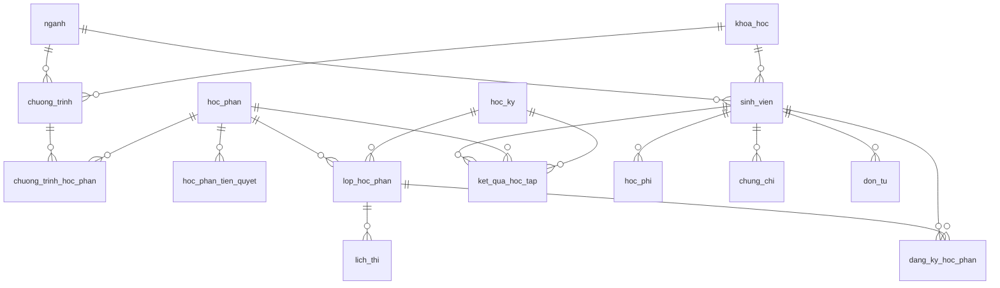
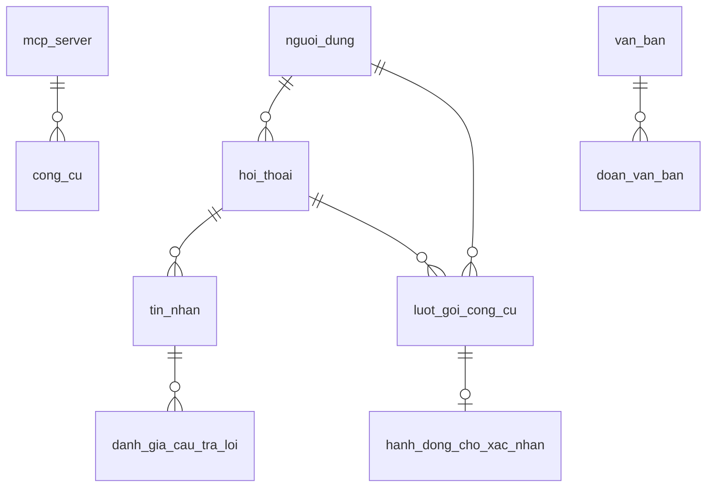

# 03. Cơ sở dữ liệu (Microsoft SQL Server)

Hai CSDL tách biệt, mô phỏng thực tế "hệ thống của trường" và "hệ thống trợ lý" thuộc hai nơi khác nhau:

| CSDL | Ai dùng | Script |
|---|---|---|
| `tlhv_qlsv` | chỉ `qlsv_api` | `database/01_qlsv_schema.sql`, `03_qlsv_seed.sql` |
| `tlhv_assistant` | `assistant_api`, thư viện `rag` | `database/02_assistant_schema.sql`, `04_assistant_seed.sql` |

Tiền tố `tlhv_` (trợ lý học vụ) tránh trùng với CSDL có sẵn trên máy (vd. `QLSV` của bài tập khác — tên CSDL trong SQL Server không phân biệt hoa thường).

> **Lịch sử thiết kế:** bản thiết kế gốc dùng MySQL 8. Ngày 18/11/2026 chuyển sang SQL Server (Express) để quản lý bằng SSMS sẵn có trên máy phát triển. Tên bảng/cột giữ nguyên; xem bảng quy ước chuyển đổi bên dưới.

## Cài đặt
1. Cài SQL Server (bản **Express** miễn phí là đủ) + **SQL Server Management Studio (SSMS)** + **ODBC Driver 18 for SQL Server**.
   Máy phát triển hiện có instance `localhost\SQLEXPRESS01` (SQL Server 2025 Express).
2. Chạy lần lượt 4 file trong `database/` (thứ tự 01 → 02 → 03 → 04). Script 01, 02 tự tạo CSDL nếu chưa có, rồi xóa và tạo lại bảng.
   - **SSMS:** File → Open → chọn file → Execute (F5), lần lượt từng file.
   - **Dòng lệnh** (PowerShell, tại thư mục gốc dự án):
     ```powershell
     foreach ($f in '01_qlsv_schema','02_assistant_schema','03_qlsv_seed','04_assistant_seed') {
       sqlcmd -S ".\SQLEXPRESS01" -E -C -f 65001 -b -i "database\$f.sql"
     }
     ```
     `-E`: đăng nhập Windows; `-C`: tin cậy chứng chỉ tự ký; `-f 65001`: đọc file UTF-8 (giữ dấu tiếng Việt).
3. Đăng nhập: mặc định dùng **Windows Authentication** (để trống `DB_USER`, `DB_PASSWORD` trong `.env`), tài khoản Windows đang chạy backend phải có quyền trên 2 CSDL (người cài SQL Server mặc định là sysadmin).
   Muốn dùng SQL Server Authentication: bật "SQL Server and Windows Authentication mode" trong SSMS (Server Properties → Security), tạo login rồi điền `DB_USER`, `DB_PASSWORD`.
4. Kiểm tra trong SSMS: `SELECT ma_sv, ho_ten FROM tlhv_qlsv.dbo.sinh_vien;` → 5 dòng, tên tiếng Việt đúng dấu.

## Quy ước chuyển đổi kiểu dữ liệu (MySQL → SQL Server)
| Thiết kế gốc (MySQL) | SQL Server | Lý do / lưu ý |
|---|---|---|
| `VARCHAR`, `TEXT`, `MEDIUMTEXT` + utf8mb4 | `NVARCHAR(n)`, `NVARCHAR(MAX)` | Lưu Unicode. Literal trong SQL phải viết `N'...'`, thiếu `N` sẽ mất dấu. Model dùng `Unicode`/`UnicodeText` |
| `ENUM(...)` | `NVARCHAR` + `CHECK (... IN (...))` | SQL Server không có ENUM; CHECK vẫn chặn giá trị sai |
| `JSON` | `NVARCHAR(MAX)` + `CHECK (ISJSON(...) = 1)` | `ISJSON` chỉ nhận **object/array** → kết quả dạng số/chuỗi phải bọc, vd `{"gia_tri": ...}`. Model dùng `JSON(none_as_null=True)` để `None` lưu thành `NULL` thật |
| `TINYINT(1)` (boolean) | `BIT` | |
| `TINYINT` có số âm (`danh_gia_cau_tra_loi.diem`) | `SMALLINT` | TINYINT của SQL Server là 0..255 |
| `AUTO_INCREMENT` | `IDENTITY(1,1)` | Seed có id cố định dùng `SET IDENTITY_INSERT ... ON/OFF` |
| `DATETIME`, `DATETIME(3)` | `DATETIME2(0)`, `DATETIME2(3)` | Lưu giờ Việt Nam (naive); code chuyển qua `src/shared/time.py` |
| `DEFAULT CURRENT_TIMESTAMP` | `DEFAULT SYSDATETIME()` | Giờ của máy chủ (múi giờ máy: SE Asia Standard Time = UTC+7) |
| `ON UPDATE CURRENT_TIMESTAMP` | Trigger `AFTER UPDATE` (`don_tu`, `hoi_thoai`, `van_ban`) | Bảng có trigger: model đặt `implicit_returning=False` vì SQL Server cấm `INSERT ... OUTPUT` trên bảng có trigger |
| `UNIQUE` trên cột cho phép NULL (`nguoi_dung.ma_sv`) | Chỉ mục duy nhất **có lọc** `WHERE ma_sv IS NOT NULL` | UNIQUE thường của SQL Server chỉ cho một NULL → không tạo được nhiều admin |
| `FULLTEXT` + `MATCH ... AGAINST` | Bỏ; dùng **BM25 trong Python** | Xem `docs/06-rag.md` mục 3 |
| `utf8mb4_unicode_ci` | Collation CSDL `Vietnamese_100_CI_AS` | So sánh/sắp xếp theo tiếng Việt, không phân biệt hoa thường |

## Sơ đồ CSDL `tlhv_qlsv`



### Quy tắc nghiệp vụ cài trong qlsv_api
- **Học phần đạt:** điểm chữ khác F. Với học phần học nhiều lần, lấy **lần có điểm hệ 4 cao nhất** để tính GPA tích lũy.
- **GPA tích lũy:** Σ(điểm hệ 4 × tín chỉ) / Σ tín chỉ, chỉ tính học phần đạt, làm tròn 2 chữ số.
- **Tín chỉ tích lũy:** tổng tín chỉ các học phần đạt (mỗi học phần tính 1 lần).
- **Cảnh báo học vụ (giả lập):** GPA tích lũy < 1.20 hoặc có ≥ 2 học phần F chưa học lại đạt → dùng `tin_chi_toi_da_canh_bao`.
- **Đăng ký học phần** (`POST /internal/students/{ma_sv}/registrations`; bản chỉ kiểm tra không ghi: `.../registrations/check`), kiểm tra theo thứ tự, trả mã lỗi:
  | Kiểm tra | Mã lỗi |
  |---|---|
  | Sinh viên đang học (`trang_thai='dang_hoc'`) | `SV_KHONG_DANG_HOC` |
  | Lớp tồn tại | `LOP_KHONG_TON_TAI` |
  | Học kỳ của lớp đang mở đăng ký (now ∈ [dang_ky_tu, dang_ky_den]) | `NGOAI_THOI_GIAN_DANG_KY` |
  | Chưa đăng ký lớp khác của cùng học phần trong học kỳ | `DA_DANG_KY_HOC_PHAN` |
  | Đã đạt học phần (không cho học cải thiện trong bản giả lập) | `DA_DAT_HOC_PHAN` |
  | Đạt đủ học phần tiên quyết | `CHUA_DAT_TIEN_QUYET` |
  | Lớp còn chỗ (đếm `da_dang_ky`) | `LOP_DA_DAY` |
  | Không trùng lịch (cùng thứ, khoảng tiết giao nhau) với lớp đã đăng ký cùng học kỳ | `TRUNG_LICH` |
  | Tổng tín chỉ sau đăng ký ≤ giới hạn | `VUOT_TIN_CHI_TOI_DA` |
- **Đơn từ:** `ma_don` = `DT-{năm}-{số thứ tự 4 chữ số}`. Bảo lưu chỉ khi đang học và không nợ học phí học kỳ hiện tại (`NO_HOC_PHI`). Phúc khảo chỉ cho học phần có điểm trong học kỳ gần nhất.
- Hằng số thời gian "hiện tại" lấy từ biến môi trường `DEMO_NOW` nếu có (vd `2026-11-20T09:00:00+07:00`) để demo ổn định; không có thì dùng giờ hệ thống.

### Làm rõ quy tắc (chốt ở Giai đoạn 2)
- **Học kỳ hiện tại:** học kỳ có `ngay_bat_dau ≤ hôm nay ≤ ngay_ket_thuc`; nếu đang giữa 2 học kỳ thì lấy học kỳ bắt đầu gần nhất. **Học kỳ đang mở đăng ký:** `dang_ky_tu ≤ now ≤ dang_ky_den`.
- **"Học kỳ gần nhất" khi phúc khảo** = học kỳ **đã kết thúc gần nhất** của toàn trường (với `DEMO_NOW`: HK2 2025-2026), không phải "học kỳ gần nhất mà sinh viên có điểm".
- **Học phần còn thiếu để tốt nghiệp** = mọi học phần trong chương trình chưa đạt, kể cả tự chọn. `du_dieu_kien` = đủ tín chỉ + GPA ≥ tối thiểu + không thiếu học phần bắt buộc + chứng chỉ GDTC, GDQP (+ ngoại ngữ nếu chương trình yêu cầu); kèm `ly_do_chua_du[]`.
- **Cảnh báo học vụ:** sinh viên chưa có điểm nào thì không bị cảnh báo.
- **Đăng ký lại sau khi hủy:** do ràng buộc UNIQUE (sinh_vien_id, lop_hoc_phan_id), bản ghi cũ được kích hoạt lại thay vì chèn mới.
- **Hủy đăng ký:** chỉ trong thời gian đăng ký; lớp chưa đăng ký → `CHUA_DANG_KY_LOP`.
- **Đơn của sinh viên khác** trả 404 (không tiết lộ đơn có tồn tại).

### Mã lỗi bổ sung của qlsv_api
| Mã | HTTP | Khi nào |
|---|---|---|
| `THIEU_TOKEN_NOI_BO`, `TOKEN_NOI_BO_KHONG_HOP_LE` | 401 | Thiếu / sai header `X-Internal-Token` |
| `SV_KHONG_TON_TAI`, `HOC_KY_KHONG_TON_TAI`, `DON_KHONG_TON_TAI`, `HOC_PHI_KHONG_TON_TAI`, `CHUONG_TRINH_KHONG_TON_TAI` | 404 | Không tìm thấy |
| 9 mã lỗi đăng ký ở bảng trên, `CHUA_DANG_KY_LOP`, `NO_HOC_PHI`, `KHONG_CO_DIEM_HOC_KY_GAN_NHAT`, `DON_DA_KET_THUC` (sửa đơn đã `hoan_tat`/`tu_choi`) | 409 | Vi phạm quy tắc nghiệp vụ |
| `DU_LIEU_KHONG_HOP_LE` | 422 | Body/tham số/nội dung đơn sai định dạng |

### Chống đăng ký trùng khi nhiều yêu cầu đến cùng lúc (SQL Server)
- Trong một transaction: khóa hàng `sinh_vien` rồi hàng `lop_hoc_phan` bằng table hint **`WITH (UPDLOCK, ROWLOCK)`**, sau đó mới đếm sĩ số / kiểm tra / ghi; commit nhả khóa. Luôn khóa theo cùng thứ tự để tránh deadlock.
  **Không dùng `with_for_update()`**: SQLAlchemy bỏ qua nó một cách im lặng với SQL Server (câu SQL không có khóa) → dùng `lock_for_update()` trong `shared/locking.py` (bọc `with_hint`).
- Mã đơn sinh dưới khóa khoảng `WITH (UPDLOCK, HOLDLOCK)`; UNIQUE `ma_don` là chốt chặn cuối.
- Cả 2 CSDL bật **`READ_COMMITTED_SNAPSHOT`**: lệnh đọc không bị chặn bởi hàng đang ghi dở của transaction khác (nếu không, 2 sinh viên đăng ký 2 lớp KHÁC nhau vẫn phải chờ nhau vì câu đếm sĩ số quét bảng `dang_ky_hoc_phan`).
- Minh chứng: `tests/qlsv/test_locking.py` mở 2 kết nối thật; kết nối thứ hai bị chặn (lỗi 1222 sau `LOCK_TIMEOUT 1000`). Bỏ UPDLOCK thì test này thất bại.
- Trigger `updated_at` bỏ qua khi câu UPDATE đã tự đặt `updated_at` (`IF UPDATE(updated_at) RETURN`), để giờ theo `DEMO_NOW` không bị ghi đè bằng giờ máy.

## Sơ đồ CSDL `tlhv_assistant`



### Ghi chú
- `nguoi_dung.ma_sv`, `ma_khoa` sao chép từ `tlhv_qlsv` khi tạo tài khoản (script `seed_users.py`).
- `luot_goi_cong_cu` là nguồn dữ liệu chính cho Chương 4 (độ chính xác chọn công cụ, độ trễ, tỉ lệ bị chặn).
- `doan_van_ban.vector_id` = id của vector trong ChromaDB (collection `quy_che`), dạng `vb{van_ban_id}_d{thu_tu}`.

### Tài khoản mẫu (tạo bằng `backend/scripts/seed_users.py`)
| Email | Mật khẩu | Vai trò | ma_sv | ma_khoa |
|---|---|---|---|---|
| sv22001@truong.example | `Sv@123456` | sinh_vien | SV22001 | K22 |
| sv22002@truong.example | `Sv@123456` | sinh_vien | SV22002 | K22 |
| sv21001@truong.example | `Sv@123456` | sinh_vien | SV21001 | K21 |
| sv23001@truong.example | `Sv@123456` | sinh_vien | SV23001 | K23 |
| sv22003@truong.example | `Sv@123456` | sinh_vien | SV22003 | K22 |
| admin@truong.example   | `Admin@123456` | admin | – | – |
