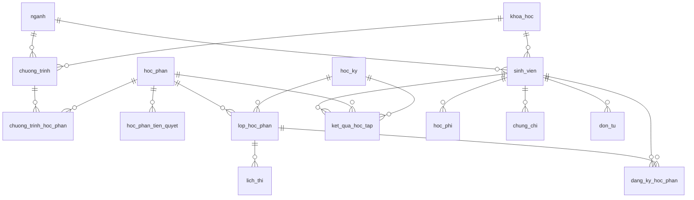
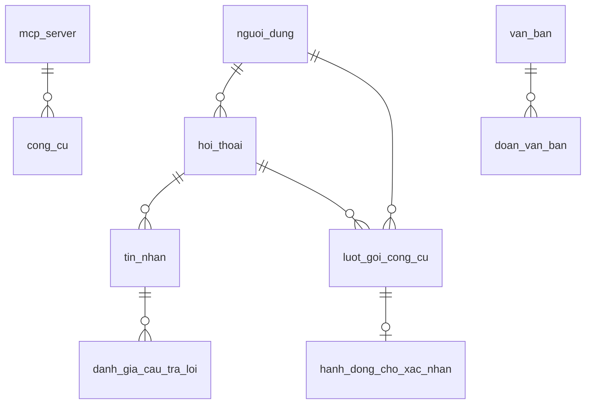

# 03. Cơ sở dữ liệu (MySQL 8)

Hai CSDL tách biệt, mô phỏng thực tế "hệ thống của trường" và "hệ thống trợ lý" thuộc hai nơi khác nhau:

| CSDL | Ai dùng | Script |
|---|---|---|
| `qlsv` | chỉ `qlsv_api` | `database/01_qlsv_schema.sql`, `03_qlsv_seed.sql` |
| `assistant` | `assistant_api`, thư viện `rag` | `database/02_assistant_schema.sql`, `04_assistant_seed.sql` |

## Cài đặt
1. Cài MySQL Server 8.x (MySQL Installer cho Windows) + MySQL Workbench.
2. Mở `my.ini` (thường ở `C:\ProgramData\MySQL\MySQL Server 8.x\my.ini`), trong mục `[mysqld]` thêm:
   ```ini
   innodb_ft_min_token_size=1
   character-set-server=utf8mb4
   collation-server=utf8mb4_unicode_ci
   ```
   Khởi động lại dịch vụ MySQL (services.msc → MySQL80 → Restart).
   *Lý do:* mặc định MySQL bỏ qua từ dưới 3 ký tự khi tìm FULLTEXT, làm mất nhiều âm tiết tiếng Việt như "đi", "kỳ", "nợ".
3. Tạo user:
   ```sql
   CREATE USER 'troly'@'localhost' IDENTIFIED BY 'doi_mat_khau';
   GRANT ALL PRIVILEGES ON qlsv.* TO 'troly'@'localhost';
   GRANT ALL PRIVILEGES ON assistant.* TO 'troly'@'localhost';
   FLUSH PRIVILEGES;
   ```
4. Chạy lần lượt 4 file trong `database/` (Workbench: File → Run SQL Script, hoặc `mysql -u root -p < database/01_qlsv_schema.sql`).

Phương án khác: `docker compose up -d` (xem `docker-compose.yml`), các script được chạy tự động lần đầu.

## Sơ đồ CSDL `qlsv`



### Quy tắc nghiệp vụ cài trong qlsv_api
- **Học phần đạt:** điểm chữ khác F. Với học phần học nhiều lần, lấy **lần có điểm hệ 4 cao nhất** để tính GPA tích lũy.
- **GPA tích lũy:** Σ(điểm hệ 4 × tín chỉ) / Σ tín chỉ, chỉ tính học phần đạt, làm tròn 2 chữ số.
- **Tín chỉ tích lũy:** tổng tín chỉ các học phần đạt (mỗi học phần tính 1 lần).
- **Cảnh báo học vụ (giả lập):** GPA tích lũy < 1.20 hoặc có ≥ 2 học phần F chưa học lại đạt → dùng `tin_chi_toi_da_canh_bao`.
- **Đăng ký học phần** (`POST /internal/students/{ma_sv}/registrations`), kiểm tra theo thứ tự, trả mã lỗi:
  | Kiểm tra | Mã lỗi |
  |---|---|
  | Sinh viên đang học (`trang_thai='dang_hoc'`) | `SV_KHONG_DANG_HOC` |
  | Lớp tồn tại | `LOP_KHONG_TON_TAI` |
  | Học kỳ của lớp đang mở đăng ký (now ∈ [dang_ky_tu, dang_ky_den]) | `NGOAI_THOI_GIAN_DANG_KY` |
  | Chưa đăng ký lớp khác của cùng học phần trong học kỳ | `DA_DANG_KY_HOC_PHAN` |
  | Đã đạt học phần (không cho học cải thiện trong bản giả lập) | `DA_DAT_HOC_PHAN` |
  | Đạt đủ học phần tiên quyết | `CHUA_DAT_TIEN_QUYET` |
  | Lớp còn chỗ (đếm `da_dang_ky`) | `LOP_DA_DAY` |
  | Không trùng lịch (cùng thứ, khoảng tiết giao nhau) với lớp đã đăng ký cùng học kỳ | `TRUNG_LICH` |
  | Tổng tín chỉ sau đăng ký ≤ giới hạn | `VUOT_TIN_CHI_TOI_DA` |
- **Đơn từ:** `ma_don` = `DT-{năm}-{số thứ tự 4 chữ số}`. Bảo lưu chỉ khi đang học và không nợ học phí học kỳ hiện tại (`NO_HOC_PHI`). Phúc khảo chỉ cho học phần có điểm trong học kỳ gần nhất.
- Hằng số thời gian "hiện tại" lấy từ biến môi trường `DEMO_NOW` nếu có (vd `2026-11-20T09:00:00+07:00`) để demo ổn định; không có thì dùng giờ hệ thống.

## Sơ đồ CSDL `assistant`



### Ghi chú
- `nguoi_dung.ma_sv`, `ma_khoa` sao chép từ `qlsv` khi tạo tài khoản (script `seed_users.py`).
- `luot_goi_cong_cu` là nguồn dữ liệu chính cho Chương 4 (độ chính xác chọn công cụ, độ trễ, tỉ lệ bị chặn).
- `doan_van_ban.vector_id` = id của vector trong ChromaDB (collection `quy_che`), dạng `vb{van_ban_id}_d{thu_tu}`.

### Tài khoản mẫu (tạo bằng `backend/scripts/seed_users.py`)
| Email | Mật khẩu | Vai trò | ma_sv | ma_khoa |
|---|---|---|---|---|
| sv22001@truong.example | `Sv@123456` | sinh_vien | SV22001 | K22 |
| sv22002@truong.example | `Sv@123456` | sinh_vien | SV22002 | K22 |
| sv21001@truong.example | `Sv@123456` | sinh_vien | SV21001 | K21 |
| sv23001@truong.example | `Sv@123456` | sinh_vien | SV23001 | K23 |
| sv22003@truong.example | `Sv@123456` | sinh_vien | SV22003 | K22 |
| admin@truong.example   | `Admin@123456` | admin | – | – |
